  

  

<h3 align="center">Me retrouver</h3>

  
  
  

 

<h2 align="center">À propos de moi</h2>

<table align="center">
  <tr>
    <td width="58%">
      Bonjour ! Je suis <b>Céline</b>, diplômée d'un <b>Master Finance des Banques et Assurances</b> (mémoire noté <b>19,75/20</b>).
      J'aime relier la rigueur de la finance à la puissance de la data.
        
      <b>&rsaquo;</b> 20 mois d'expérience en audit légal, banque de détail et comptabilité d'assurance 
      <b>&rsaquo;</b> SCF, fiscalité (G50, TVA, IBS, IRG), PC Compta, PC Paie 
      <b>&rsaquo;</b> Python, SQL et IA pour automatiser le travail comptable 
      <b>&rsaquo;</b> Créatrice d'<b>Archivio</b>, labellisé « Projet innovant » 
      <b>&rsaquo;</b> Échecs, piano et dessin à mes heures
        
      <i>Ouverte à des opportunités en audit, comptabilité ou analyse financière.</i>
    </td>
    <td width="42%" align="center">
      
    </td>
  </tr>
</table>

 

<h2 align="center">Projet phare : Archivio</h2>

  

  Logiciel de gestion des documents comptables conforme au <b>SCF</b>, né de mon mémoire de Master. 
  Il intègre des <b>modèles de langage (API, RAG)</b> pour classer et exploiter automatiquement les pièces comptables, 
  afin de simplifier la gestion comptable des <b>start-up</b>.

 

<h2 align="center">Technologies</h2>

<h4 align="center">Data, IA et web</h4>

  

<h4 align="center">Finance et outils métier</h4>

  
  
  
  
  
   
  
  
  

 

<h2 align="center">Parcours</h2>

| Poste | Structure | 
|:---|:---|
| Assistante administrative et comptable | Promotion immobilière |
| Stagiaire en banque de détail | Banque | 
| Assistante en audit | Cabinet de commissariat aux comptes | 
| Stagiaire en comptabilité des assurances | Compagnie d'assurance | 

  <b>Langues :</b> Français (C2) · Anglais (C1, TOEFL) · Arabe · Kabyle · Espagnol (notions)

 

<h2 align="center">Statistiques</h2>

  

  

  

